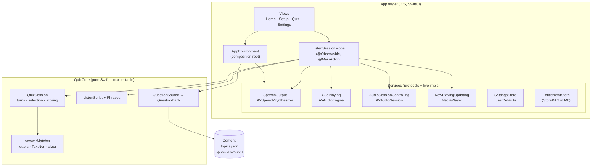

# Architecture

BuckleUp Quiz is an offline, native iOS app. The game rules live in a pure-Swift package. The
app layer handles audio, UI and persistence. See the [ADRs](adr/README.md) for the reasoning.



## Listen-mode loop

For each turn, `QuizSession.advance()` picks the next question for the next player.
`ListenScript.steps(for:)` turns it into steps:

```
say(number) → say(question) → say(options)? → cue(think) → think(8s) → say(answer) → say(fun fact)? → wait(2s)
```

`ListenSessionModel` runs these steps in a single cancellable `Task`:

- **Pause** cancels the task. **Resume** re-runs the current step: it re-reads a sentence, or
  continues the countdown from where it stopped.
- **Skip** jumps to the next turn. **Repeat** jumps back to the question step.
- **Interruptions** (phone calls) pause. When they end, the app says "Welcome back!" and
  repeats the question.
- **Remote commands** map to play, pause, skip and repeat.

## Voice mode (M4, planned)

Same loop, with `cue(listening)` + `listen(thinkTime)` in place of the plain think step.
Transcripts go to `VoiceCommand.parse`, then to `AnswerMatcher.match`, then
`QuizSession.record`, then `Phrases.feedback` is spoken. The audio session is `.playAndRecord`
over Bluetooth HFP, fixed for the whole session (ADR-0008).

## Where things go

| You're adding… | Put it in |
|---|---|
| A rule about answers, scoring, selection or wording | `Packages/QuizCore` + a test |
| Anything touching AVFoundation, StoreKit, SwiftData, UIKit | `App/Sources/Services/…` behind a protocol |
| A screen | `App/Sources/Features/<Feature>/` |
| Questions or topics | `Content/` (see [CONTENT.md](CONTENT.md)) |
| A structural decision | `docs/adr/` |
